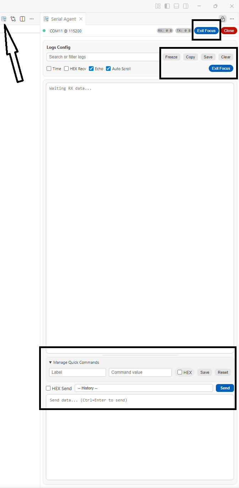
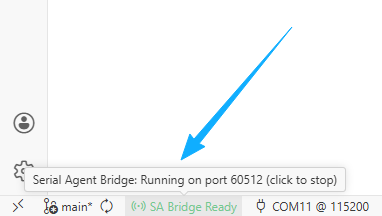
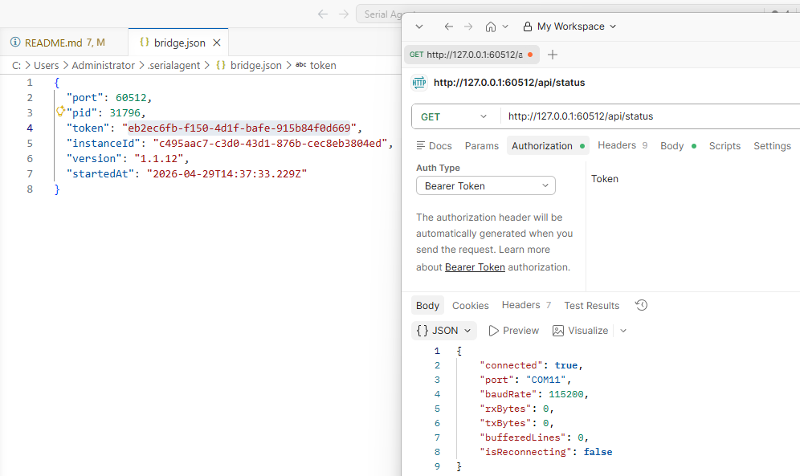
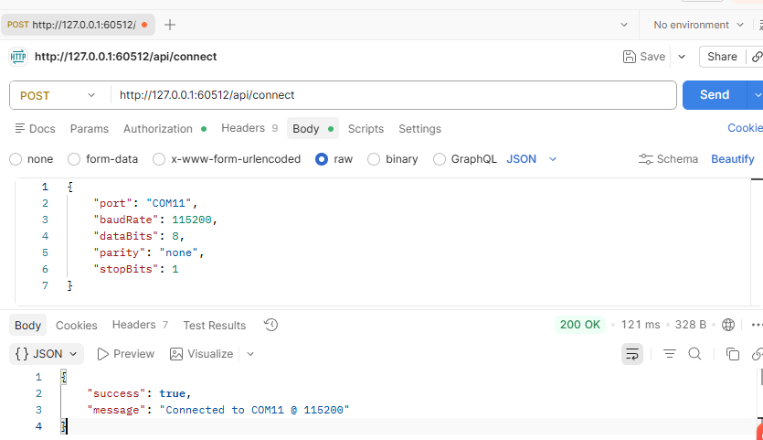
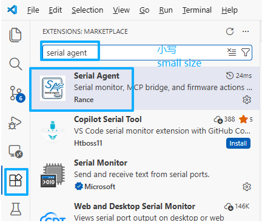

<p align="center">
  
</p>

# Serial Agent Plus VS Code 插件

English version: [README_EN.md](README_EN.md)

> **声明**：本插件是 **Serial Agent Plus** 的 VS Code 扩展。Serial Agent Plus 是 [Rance-OwO/Serial-Agent](https://github.com/Rance-OwO/Serial-Agent) 的非官方衍生版，主要增强串口功能；上游版权归原项目所有，本仓库保留原始版权声明。

`Serial Agent Plus` 是一个面向嵌入式调试场景的 VS Code 插件。它把串口工作台和本地 Bridge 运行时收拢到同一个工作区里，让你既可以手动完成串口调试，也可以把同一套真实运行时暴露给 AI 客户端。

上游项目（原始项目）：

- [https://github.com/Rance-OwO/Serial-Agent](https://github.com/Rance-OwO/Serial-Agent)

> [!IMPORTANT]
> 只安装插件，也可以把它当作本地串口工作台使用。
> 如果你希望接上 AI 闭环，还需要继续配置 `Serial Agent Plus MCP` 和 `Serial Agent Plus Skill`。
> 插件负责本地运行时，MCP 负责把能力暴露给 AI，Skill 负责把工作流约束和使用规则喂给 AI。

## 这是什么插件

很多串口工具只解决两件事：看日志、发命令。`Serial Agent Plus` 进一步把本地嵌入式调试链路里常见的几个环节合到 VS Code 里：

- 串口连接、断开、日志观察、命令发送
- 本地 Bridge Server，供 `Serial Agent Plus MCP` 调用

如果你只是想把 VS Code 当作串口工作台，它已经能单独使用。  
如果你希望让 AI 访问同一套真实串口状态和日志缓冲，就继续把 `MCP` 和 `Skill` 接上。

## 适合什么场景

- 你只想在 VS Code 里完成串口连接、日志观察和命令发送
- 你希望让 AI 通过 MCP 调用真实的本地串口状态和日志缓冲，而不是只读文档
- 你希望把“观察日志 -> 发命令 -> 分析问题 -> 再验证”串成一条可复用工作流

## 它和 MCP / Skill 是什么关系

这三个部分的职责不同：

- 插件：本地运行时，负责串口、日志和 Bridge 生命周期
- MCP：工具暴露层，通过 stdio MCP tools 把插件能力提供给 AI 客户端
- Skill：工作流层，帮助 AI 选择正确工具、判断任务模式，并按证据汇报

它们组成的典型链路是：

```text
AI IDE / Agent Client
    -> Serial Agent Plus MCP
    -> Local Bridge
    -> Serial Agent Plus VS Code Extension
    -> Serial Device
```

如果你的目标只是“本地串口工具”，可以停在插件这一层。  
如果你的目标是“AI 参与真实调试闭环”，就需要把后两层一起接上。

## 插件里能直接做什么

### 串口工作台

- 在 VS Code 中直接连接和断开串口设备
- 在同一视图里查看 RX 日志并发送 TX 命令
- 支持日志搜索、过滤、清空和 RX/TX 计数
- RX 日志与 TX 发送支持 `UTF-8` / `GBK` 文本编码切换（适配打印中文的固件）
- 串口参数（端口、波特率、校验等）收在可折叠的 Config 抽屉里，默认收起；波特率内置常用值下拉（含 4800 / 256000 等）
- 勾选 `Time` 后 RX 与 TX 日志逐行显示 `[HH:MM:SS.mmm]` 时间戳
- 发送区支持 `Cycle` 周期发送（可指定 ms 周期，默认关闭）
- HEX 显示的空闲换行：字节间隔超过 `Wrap` 选项（默认 20ms，最低 1ms，位于 Encoding 前）即换行提交，不再按串口分块断行，同一连发数据的 hex 字节合并为一行；文本显示仍按 `\r\n` 换行，无 `\r\n` 的数据（提示符/回显）保持实时行
- `Ctrl+C`：日志区有选中文本时执行系统复制，无选中时才向设备发送 ETX 中断
- Freeze 冻结日志视图：冻结期间数据仍在后台累积但视图完全停住（便于阅读/复制定格画面，选中文本不会被新日志冲掉），Resume 后一次性刷新；选中文本期间视图同样暂停重建，保证 `Ctrl+C` 可复制
- 日志面板内置终端直连：点击日志区后，可打印字符进入本地输入行并直接拼接在设备实时提示符行后显示（如 `msh > ls▌`，无实时行时回退 `>` 前缀，不再单独显示一行），`Enter` 将整行连同 CR 发送给设备；`Tab`/`↑`/`↓`/方向键/Home/End/Del 等**控制键立即透传**对应字节序列（ESC[A/B 等）给设备；未连接时发送会自动按当前配置连接。`↑/↓` 历史召回与 `Tab` 补全通过设备 redraw 同步回本地输入行，此时设备编辑缓冲已持有该行——Enter 只补发 CR，本地改过则先退格清空设备行再整行发送，避免命令被设备追加成 `lsls`
- 发送框字符模式支持嵌入转义序列：`\r` `\n` `\t` `\x41` `\\` 会转换为对应字节发送
- 支持在侧边栏使用，也支持通过 `Open Serial Agent Plus` 打开到独立 Tab

下图是串口面板本体。它既可以作为日常串口工具使用，也是整个 AI 调试链路的本地运行时入口。

<p align="left">
  
</p>

### 本地 Bridge 运行时

- 插件启动本地 Bridge Server，供 `Serial Agent Plus MCP` 调用
- Bridge discovery 信息写入：

```text
~/.serialagent-plus/bridge.json
```

- 插件才是真正持有串口状态和日志缓冲的运行时
- 如果插件没有启动，即使 MCP 进程能起来，tool 调用仍然会失败

如果你后面要接 AI 闭环，这个 Bridge 是关键中间层。  
它不是给浏览器地址栏直接访问的普通网页，而是一个带认证的本地 API 运行时。

下面几张图对应的是 Bridge 相关的教学场景：

- 第一张图：本地发现文件 `bridge.json`
- 第二张图：浏览器直接访问 Bridge 接口时的认证提示
- 第三张图：需要带 token 的 API 调试方式

<p align="left">
  
</p>

<p align="left">
  
</p>

<p align="left">
  
</p>

## 安装

### 方式 1：Marketplace 安装

如果你通过 Visual Studio Marketplace 安装本插件，直接搜索 `Serial Agent Plus` 即可。

这条路径适合普通使用者，也是最省事的安装方式。

<p align="left">
  
</p>

### 方式 2：安装 VSIX

如果你拿到的是 Release 页面里的 `.vsix` 文件，可以直接在 VS Code 里安装。

常见方式有两种：

1. 在 VS Code 中打开 `Extensions`
2. 点击右上角 `...`
3. 选择 `Install from VSIX...`
4. 选中下载好的 `.vsix` 文件并完成安装

或者使用命令行：

```bash
code --install-extension serialagent-plus-<version>.vsix
```

这条路径适合：

- 你在使用仓库 Release 产物
- 你想安装某个固定版本
- Marketplace 还未更新到你想要的版本

### 方式 3：从源码构建

在仓库根目录执行：

```bash
npm install
npm --workspace packages/serialagent-plus run build
npm --workspace packages/serialagent-plus run pack
```

打包后的 VSIX 会输出到 `packages/serialagent-plus/`。

这条路径适合：

- 你正在开发或验证插件
- 你想安装本地源码对应的最新构建结果

## 快速开始

### 路径 1：把它当作本地串口工作台

这是最短路径。你不需要先配置 MCP，也不需要先配置 Skill。

1. 在 VS Code 中打开 `Serial Agent Plus` 视图容器
2. 选择 COM 口和波特率
3. 点击 `Open` 建立串口连接
4. 在日志区观察 RX 输出
5. 在 TX 区发送测试命令
6. 如果需要更聚焦的调试视图，可以切到 `Focus Mode`

常见入口包括：

- `Open Serial Agent Plus`
- `Toggle Focus Mode`
- `Refresh Serial Ports`
- `Disconnect Serial Port`
- `Clear Serial Log`

如果你的目标只是串口连接、日志观察和发命令，到这里就已经可以开始使用。

### 路径 2：把 AI 闭环一起接上

如果你希望 AI 真正调用本地串口状态和日志缓冲，而不是只读 README 或猜测日志，你需要继续完成 `Bridge -> MCP -> Skill` 这条链路。

#### 第一步：先确保插件已经在运行

这是整个闭环的前提。  
插件必须先启动，因为 Bridge、本地串口状态和日志缓冲都由插件持有。

你可以先完成下面任一动作：

- 在 VS Code 侧边栏打开 `Serial Agent Plus`
- 通过命令面板执行 `Open Serial Agent Plus`

#### 第二步：确认本地 Bridge 已经启动

插件启动本地 Bridge 后，会写入发现文件：

```text
~/.serialagent-plus/bridge.json
```

在 Windows 上通常对应：

```text
C:\Users\<你的用户名>\.serialagent-plus\bridge.json
```

这个文件里会包含当前 Bridge 的：

- `port`
- `token`
- `pid`
- `startedAt`

它的作用不是“让你手工改配置”，而是让 `Serial Agent Plus MCP` 知道当前应该连接哪个本地 Bridge 实例。

#### 第三步：理解为什么浏览器直接打开 Bridge 会报 `AUTH_REQUIRED`

很多人第一次会直接访问：

```text
http://127.0.0.1:<port>/api/status
```

然后看到类似：

```json
{"success":false,"error":{"code":"AUTH_REQUIRED","message":"Missing Authorization header"}}
```

这不是故障，恰恰说明 Bridge 已经在运行。  
原因是：Bridge 不是普通网页，而是一个需要 `Bearer Token` 的本地 API。

也就是说：

- 浏览器地址栏直接打开：通常不适合
- PowerShell / curl / Postman / Apifox：可以带 token 调试
- MCP 客户端：本质上也是先读 `bridge.json` 再带 token 访问

#### 第四步：配置 `Serial Agent Plus MCP`

推荐继续阅读：

- [../serialagent-plus-mcp/README.md](../serialagent-plus-mcp/README.md)
- [../../README.md](../../README.md)

最常见的 MCP 配置示例是：

```json
{
  "type": "stdio",
  "command": "npx",
  "args": ["-y", "@fnote2030/serialagent-plus-mcp"],
  "startup_timeout_sec": 15
}
```

这段配置的含义是：

- MCP 进程通过 stdio 与 AI 客户端通讯
- MCP 进程启动后，会读取 `~/.serialagent-plus/bridge.json`
- 它再把工具调用转发给插件启动的本地 Bridge

如果插件没启动，可能会出现“看起来 MCP 已经配置好了，但工具调用还是失败”的情况。  
这通常不是 MCP 逻辑坏了，而是插件侧本地运行时没有准备好。

#### 第五步：把 `Serial Agent Plus Skill` 喂给 AI

推荐继续阅读：

- [../serialagent-plus-skill/README.md](../serialagent-plus-skill/README.md)
- [../serialagent-plus-skill/SKILL.md](../serialagent-plus-skill/SKILL.md)

`Skill` 的作用不是提供运行时能力，而是帮助 AI 更稳定地使用这套 MCP 工具。  
例如它会帮助 AI 判断：

- 当前是只读检查
- 还是开环串口交互

如果你的 AI 客户端支持 skill 安装，优先走客户端自己的安装机制。  
如果客户端不支持 skill 安装，也可以直接把 `SKILL.md` 内容喂给模型。

#### 第六步：做一次最小闭环验证

当插件、MCP、Skill 都到位后，推荐做一次最小验证，而不是直接上复杂任务。

一个典型的最小验证目标是：

1. 确认插件已打开
2. 确认 Bridge 发现文件存在
3. 让 AI 通过 MCP 查看当前串口状态
4. 让 AI 列出串口
5. 如有需要，连接串口
6. 发送一个简单命令并等待响应

这一步的意义是确认：AI 看到的不是一套模拟环境，而是和你在 VS Code 里使用的是同一套真实运行时。

## 常见问题

### 1. 为什么浏览器直接打开 Bridge 会报 `AUTH_REQUIRED`

因为 Bridge 是带认证的本地 API，不是公开网页。  
直接访问时没有带 `Authorization: Bearer <token>`，所以会返回认证错误。这通常说明服务是活着的，而不是坏了。

### 2. 为什么 MCP 已经配置好了，但 tool 调用还是失败

常见原因是插件没有启动，或者插件启动后 Bridge 还没准备好。  
MCP 本身只是工具暴露层，真正持有串口状态和日志缓冲的是插件侧本地运行时。

### 3. `bridge.json` 不存在怎么办

先确认：

- VS Code 已打开
- 插件已安装并激活
- 你已经打开过 `Serial Agent Plus` 面板或让扩展正常启动

如果发现文件不存在，通常说明 Bridge 还没起来，而不是 MCP 文档写错了。

### 4. 我只想把它当串口工具用，还需要配 MCP 和 Skill 吗

不需要。  
如果你只做本地串口连接、日志观察和命令发送，插件本身就够了。

## 更多文档入口

如果你需要的不只是插件本身，而是完整的本地 AI 调试链路，可以继续阅读：

- 项目总览：[../../README.md](../../README.md)
- MCP 文档：[../serialagent-plus-mcp/README.md](../serialagent-plus-mcp/README.md)
- Skill 文档：[../serialagent-plus-skill/README.md](../serialagent-plus-skill/README.md)

## 开发说明

- 主入口：`src/extension.ts`
- 串口运行时：`src/serial-manager.ts`
- Webview 协调器：`src/serial-panel-provider.ts`
- Bridge 服务：`src/bridge-server.ts`
- 前端资源：`media/main.js`、`media/main.css`

插件构建与打包：

```bash
npm test
npm --workspace packages/serialagent-plus run build
npm --workspace packages/serialagent-plus run pack
```
